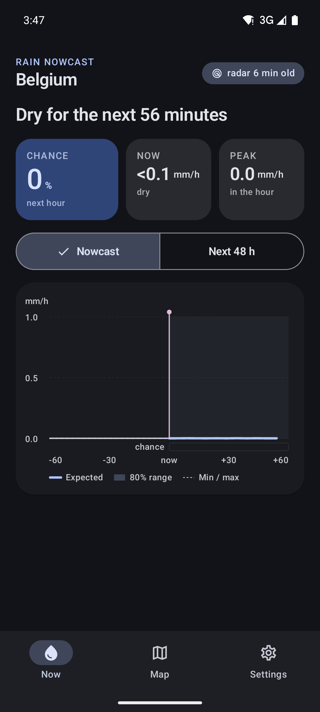
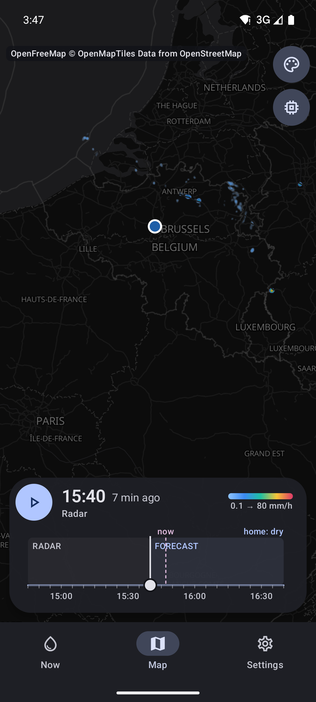
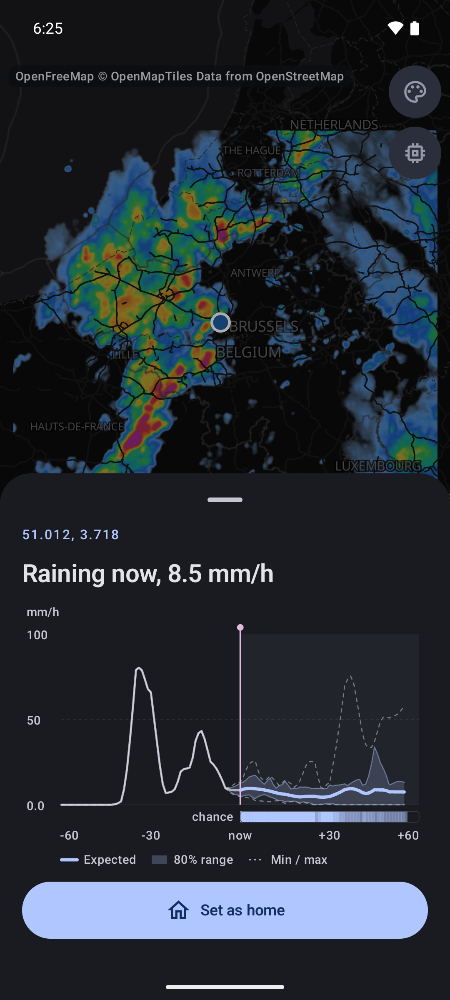
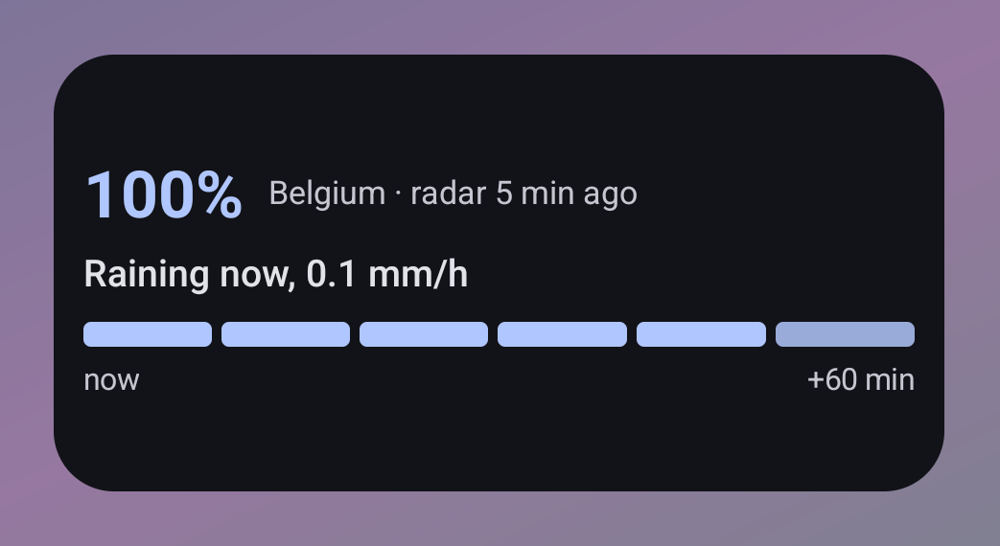
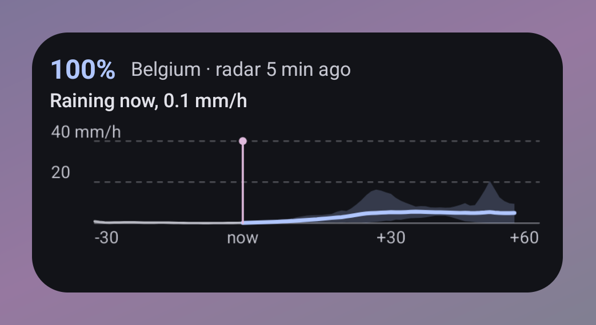
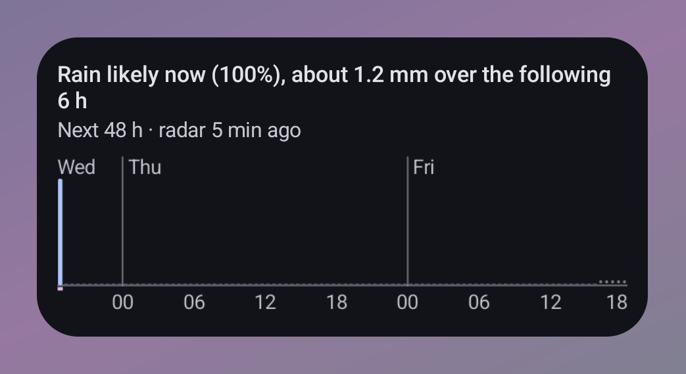
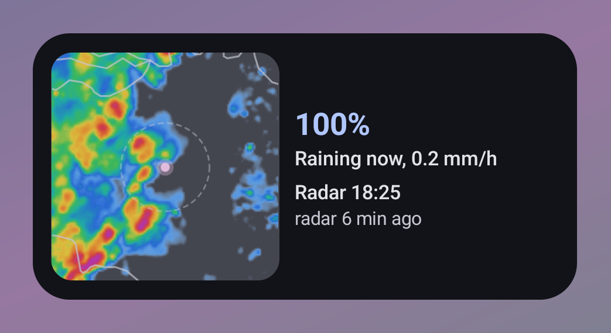
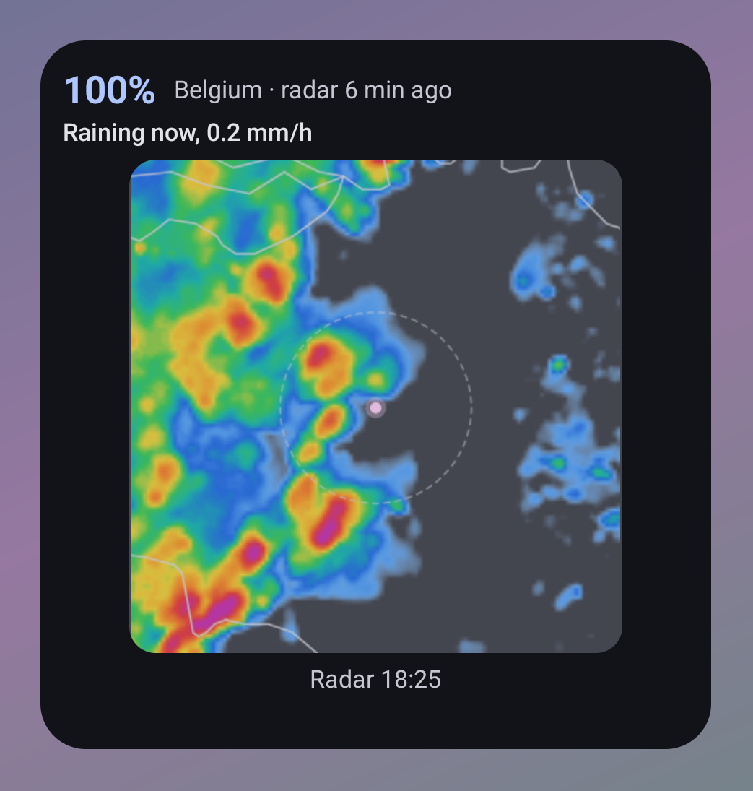
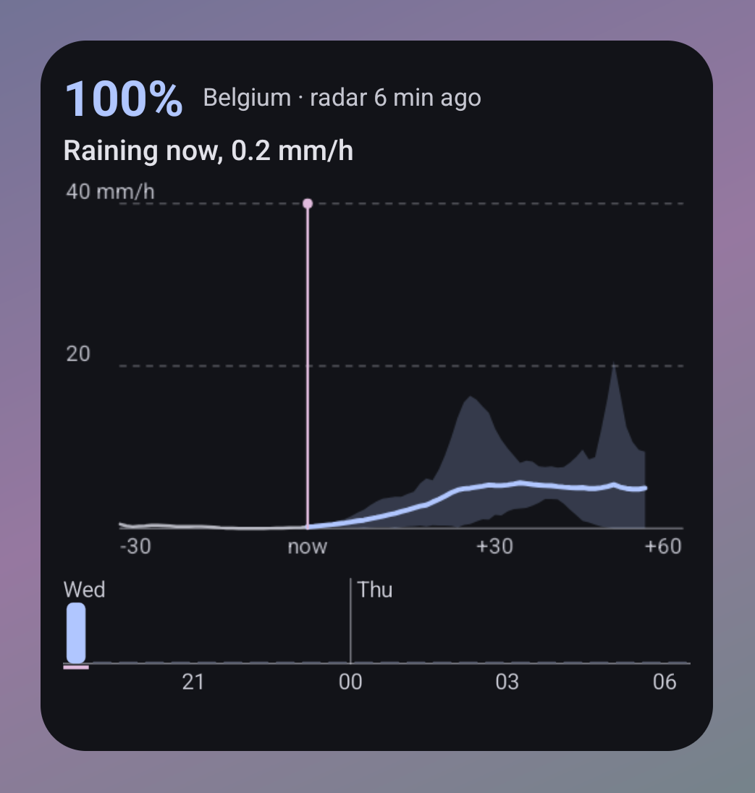

# Rain Nowcast for Android

Minute-by-minute rain for the next hour, worked out on your phone from live European radar.

<p>



</p>

Every five minutes the app takes the last hour of EUMETNET OPERA radar, estimates how the rain moves and grows, and runs it an hour ahead as a 10-member STEPS-style ensemble, nudged by a SmaAt-UNet neural network (ONNX). Everything runs on the device: no account, no server, no tracking.

- Next hour, minute by minute: expected rain, 80% range and chance of rain
- Next 48 hours in half-hour bars (Open-Meteo: ICON-D2, ICON-EU, IFS, with a local correction model)
- Rain map: the last hour of radar and the next hour of forecast, minute by minute; tap any place for its forecast
- Rain alerts and five home-screen widgets
- Ready-made regions: Belgium, the Netherlands, Luxembourg, North Rhine-Westphalia, Nord de France; add your own anywhere OPERA covers, with an in-app guide to training a model for it
- No radar key, or outside Europe? Open-Meteo's models instead, worldwide, no key

### Widgets

<p>




</p>
<p>


</p>

The screenshots show a real rainy hour of OPERA radar (3 May 2026), replayed.

The radar comes from MeteoGate's Open Radar Data API and needs a free personal key from [meteogate.eu](https://meteogate.eu).

The Home Assistant add-on and integration that run the same nowcast on a server live in their own repository, [Splatt345/ha-rain-nowcast](https://github.com/Splatt345/ha-rain-nowcast).

## Build

Needs JDK 17 and the Android SDK (compileSdk 36).

```bash
./gradlew :app:assembleDebug                 # app/build/outputs/apk/debug/app-arm64-v8a-debug.apk (and x86_64)
./gradlew :engine:test :app:testDebugUnitTest
./gradlew :app:assembleRelease               # one unsigned APK per ABI; F-Droid builds and signs its own
```

**Emulators without Vulkan:** the map uses MapLibre's Vulkan build. For an emulator that has no Vulkan, swap `org.maplibre.gl:android-sdk` for `org.maplibre.gl:android-sdk-opengl` (same version) in `app/build.gradle.kts` for that build only.

## Layout

| Path | What |
|---|---|
| `engine/` | Pure Kotlin/JVM, no Android; unit-tested against the Python reference |
| `engine/…/radar/` | OPERA radar: download, ranged HDF5 reads, crops, the map projection, regions |
| `engine/…/forecast/` | The nowcast: optical flow, the STEPS ensemble, the ONNX model, point forecasts, input checks |
| `engine/…/outlook/` | Open-Meteo: the 48-hour outlook and the no-radar nowcast |
| `engine/…/render/` | Rain to map and widget bitmaps |
| `engine/…/math/` | FFT, grids, random numbers |
| `app/` | The Android app: `App` and `MainActivity` at the top |
| `app/…/data/` | State and storage: the repository, settings, keys, caches, location, the forecast cycle |
| `app/…/background/` | WorkManager refresh and rain alerts |
| `app/…/ui/` | Compose screens: `now/`, `map/`, `settings/`, plus the theme and first run |
| `app/…/widget/` | Glance home-screen widgets and their configuration |
| `screenshots/` | Widget screenshots for this README |
| `fastlane/` | Store metadata in the layout F-Droid reads |
| `fdroid/` | F-Droid build metadata |

Tests mirror the same folders.

## Data

Radar © EUMETNET OPERA via MeteoGate (CC BY 4.0) · Forecasts by [Open-Meteo.com](https://open-meteo.com) (CC BY 4.0) · Map © OpenFreeMap, OpenMapTiles, OpenStreetMap contributors.

## License

Copyright (C) 2026 the Rain Nowcast contributors.

This program is free software: you can redistribute it and/or modify it under the terms of the
GNU General Public License as published by the Free Software Foundation, either version 3 of the
License, or (at your option) any later version. It is distributed in the hope that it will be
useful, but WITHOUT ANY WARRANTY; without even the implied warranty of MERCHANTABILITY or FITNESS
FOR A PARTICULAR PURPOSE. See [LICENSE](LICENSE) for the full text.

Third-party data and libraries keep their own licences: see the app's Settings → Open-source
licences (`app/src/main/assets/licenses.txt`).
